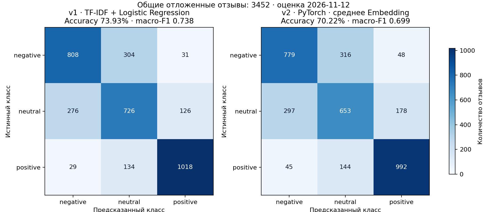

# Russian Sentiment Analyzer

[Русский](README.md) · **English**

Two educational models classify Russian product reviews as `negative`, `neutral`, or `positive`. **v1** uses TF-IDF and logistic regression. **v2** implements tokenization, data loading, embeddings, and training in PyTorch, with pandas for reading CSV files.

## The two models

| Setting | v1: scikit-learn | v2: PyTorch |
|---|---|---|
| Training and prediction | `main.py`, `predict.py` | `train_torch.py`, `predict_torch.py` |
| Text representation | TF-IDF, up to 10,000 features | Learnable 32-dimensional word embeddings |
| Classifier | LogisticRegression, `max_iter=1000` | Masked mean of embeddings, then Linear(32, 3) |
| Tokenizer | TfidfVectorizer defaults | `lower().split()`, with punctuation attached |
| Training split | 64% train, 16% validation, 20% test, stratified | 80% train, 20% validation, unstratified `random_split` |
| Training settings | scikit-learn defaults apart from `max_iter` | One epoch, batch size 4, AdamW at 0.001, cross-entropy |
| Saved artifact | `sentiment_model.joblib` | `sentiment_torch.pt` |

Both versions normalize the label `neautral` to `neutral` and remove exact duplicates and conflicting labels. There were **86,933 reviews** after cleanup. The vectorizer and word vocabulary are fitted on their respective training splits.

In v2, the collator pads to the longest input in each batch. `<PAD>` is 0 and `<UNK>` is 1. Empty input becomes one UNK token. The average excludes padding, drops word order, and feeds a linear classifier. The saved model has 128,632 vocabulary entries and 4,116,323 parameters, mostly in embeddings trained from scratch.

## Comparison of saved models

On 12 November 2026, both checkpoints were evaluated without further training on **3,452 identical reviews** from the intersection of **v1 test and v2 validation**. The provided split logic places those reviews outside both training sets and outside v1 validation.

| Metric on the shared subset | v1 | v2 |
|---|---:|---:|
| Accuracy | **73.93%** | 70.22% |
| Macro-F1 | **0.7380** | 0.6993 |
| F1 negative | **0.7163** | 0.6882 |
| F1 neutral | **0.6335** | 0.5828 |
| F1 positive | **0.8642** | 0.8270 |



v1 got 2,552 reviews right and v2 got 2,424 right, a difference of **3.71 percentage points**. Both were right on 2,203 reviews. Only v1 was right on 349 and only v2 on 221. The largest F1 gap was on the neutral class.

The rebuilt TF-IDF vocabulary and IDF values matched v1, and the complete v2 vocabulary matched its checkpoint. The files lack a dataset hash or split indices. The evaluation assumes the checkpoints came from the provided scripts and this corpus. v2 validation may have been examined earlier. The two training sets contain 55,636 and 69,547 reviews, and tokenization and training procedures differ. This is a comparison of the saved systems. An experiment designed to isolate architecture would use one shared split and evaluation protocol. [Comparison data and hashes](reports/comparison.json)

Separate validation scores were 73.88% on 13,910 reviews for v1 and 69.94% on 17,386 reviews for v2. These scores refer to different splits. [Original v1 report](reports/validation_metrics.json)

## Run on Windows

Verified with Python 3.13.2, PyTorch 2.14.1+cpu, pandas 3.0.6, scikit-learn 1.9.1, and joblib 1.6.0. v2 trains on CPU.

```powershell
git clone https://github.com/Awuiga/russian-sentiment-analyzer.git
cd russian-sentiment-analyzer
py -3.13 -m venv .venv
.\.venv\Scripts\Activate.ps1
python -m pip install -r requirements.txt
```

Place the tab-separated `women-clothing-accessories.3-class.balanced.csv` in `data/`. It must include `review` and `sentiment` columns. [RuReviews project](https://github.com/sismetanin/rureviews) · [Data and attribution](data/README.md)

```powershell
python main.py
python predict.py

python train_torch.py
python predict_torch.py
```

For v1, enter an example review at the end of training to trigger model saving. The v1 prediction loop exits on `выход`. For v2, `predict_torch.py` reads one line and prints the class. Generate the local weights by training the relevant version before running predictions. Only load trusted model files.

With both checkpoints and the original corpus, reproduce the comparison and rebuild the figure:

```powershell
python compare_models.py
python -m pip install -r requirements-report.txt
python plot_comparison.py
```

The comparison script reconstructs splits, checks vocabularies, and writes `reports/comparison.json`. It refits a separate TF-IDF vectorizer only to verify the split. The two models being scored remain unchanged. See `python compare_models.py --help` for alternate paths.

## Limitations

The domain is clothing and accessories. Sarcasm, complex negation, and transfer to other domains were not measured. Deduplication is exact, so near-duplicates can remain. In v2, seed 42 fixes the split while initialization and batch order vary. The original v2 script averages batch means for validation loss. [Verification](VERIFICATION.md)
