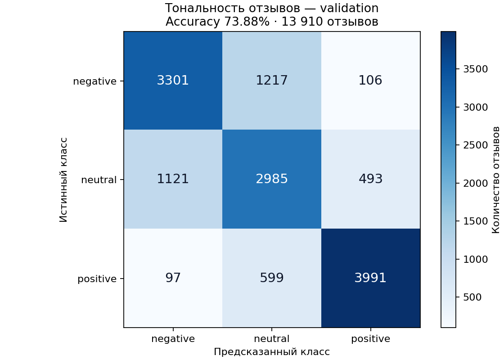

# Russian Sentiment Analyzer

Учебный классификатор тональности русскоязычных отзывов. Он относит текст к одному из трёх классов: `negative`, `neutral`, `positive`. В основе — TF-IDF и логистическая регрессия из scikit-learn.

## Как устроен проект

`main.py` читает отзывы, исправляет метку `neautral` на `neutral`, удаляет тексты с противоречивыми метками и точные дубликаты. Затем выделяет train, validation и test: сначала 80/20, после этого ещё 80/20 внутри обучающей части. В итоге доли составляют примерно 64/16/20, разбиение стратифицированное, `random_state=42`.

TF-IDF со словарём до 10 000 признаков обучается только на train. `LogisticRegression(max_iter=1000)` тоже обучается только на train. Скрипт выводит accuracy, отчёт по классам и confusion matrix **на validation**. Отложенный test в текущем коде не оценивается.

После оценки можно ввести отзыв. Затем модель вместе с TF-IDF сохраняется в `sentiment_model.joblib`. `predict.py` загружает этот файл и позволяет вводить отзывы до команды `выход`.

## Запуск

Проверялось на Windows с Python 3.13.2. Все команды выполняются из корня проекта:

```powershell
git clone https://github.com/Awuiga/russian-sentiment-analyzer.git
cd russian-sentiment-analyzer
py -3.13 -m venv .venv
.\.venv\Scripts\Activate.ps1
python -m pip install -r requirements.txt
```

Скачайте файл `women-clothing-accessories.3-class.balanced.csv` из [RuReviews](https://github.com/sismetanin/rureviews) и положите его в `data/`. Внутри файла используется табуляция; скрипт ожидает столбцы `review` и `sentiment`. Подробнее об источнике — в [data/README.md](data/README.md).

```powershell
python main.py
# После обучения введите отзыв; после этого сохранится модель.
python predict.py
# Для завершения: выход
```

Веса и исходные отзывы не входят в репозиторий. После клонирования сначала нужно обучить модель. Загружать через joblib следует только доверенные файлы.

## Результат проверочного запуска

8 ноября 2026 года код повторно запущен на локальном корпусе. После очистки осталось 86 933 отзыва: train 55 636, validation 13 910, test 17 387. **Validation accuracy — 73,88%.** Это результат текущего проверочного запуска; test не оценивался.



Метки и точные числа сохранены в [reports/validation_metrics.json](reports/validation_metrics.json). Строки матрицы — истинный класс, столбцы — предсказанный. Главная путаница возникает между отрицательными и нейтральными отзывами.

## Ограничения

Данные относятся к отзывам об одежде и аксессуарах. Качество на других темах, сарказме и сложных отрицаниях отдельно не проверено. Точные дубликаты удаляются, но поиск близких по смыслу или почти одинаковых текстов не реализован. Полученные метрики относятся к validation; это не итоговая оценка на независимом test.

Основные зависимости зафиксированы по проверенному окружению, полный lock-файл не восстанавливался. Исходная логика обучения при публикации сохранена. Результаты запуска — в [VERIFICATION.md](VERIFICATION.md). Отдельная открытая лицензия на код пока не выбрана автором.
